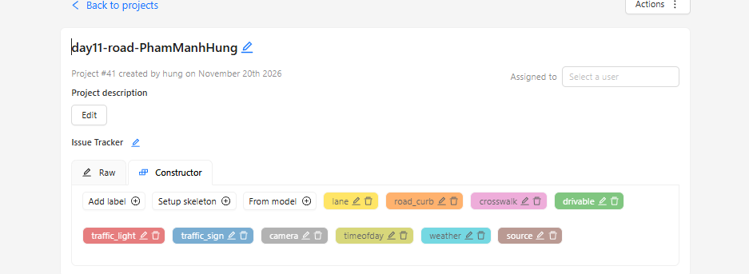
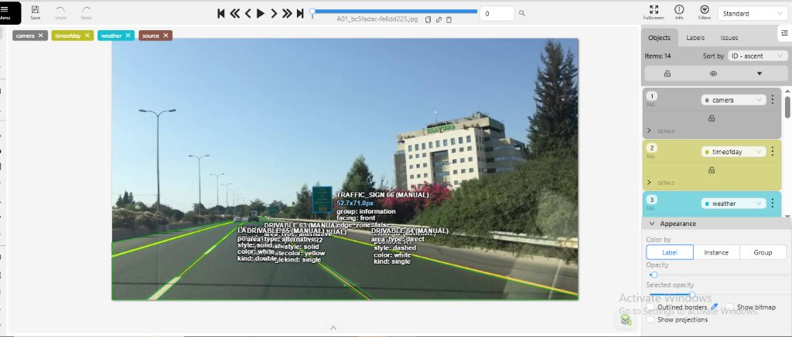
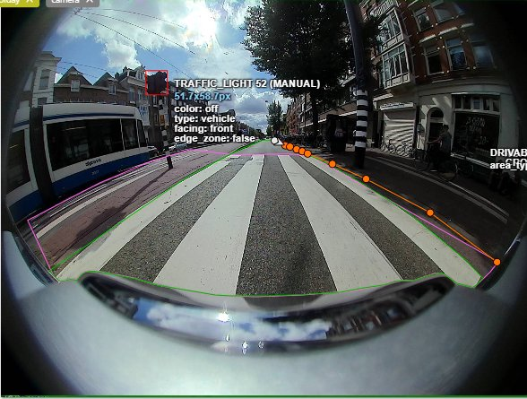
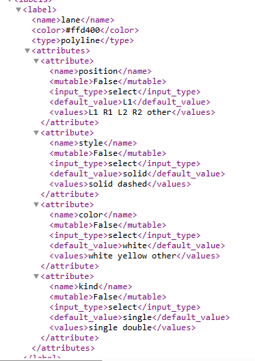

# Báo cáo cá nhân — Ngày 11
Họ tên: Phạm Mạnh Hùng               Mã học viên: 2A202603240  
Phiên bản CVAT (Help → About): CVAT v2.82.0  
Guideline: Road v1.0    Lần nộp (`revision` trong manifest): 1  
Thời điểm export (ngày giờ trên CVAT): 2026-11-21 04:29:51 UTC    Số lần nộp lại sau Rework: 0  

## 1. Kiểm project
| Mục | Đúng như guideline Road v1.0? | Ghi chú |
| --- | --- | --- |
| 6 label, đúng kiểu | Đúng | lane (polyline), road_curb (polyline), crosswalk (polygon), drivable (polygon), traffic_light (box), traffic_sign (box) |
| Thuộc tính và giá trị | Đúng | Đầy đủ thuộc tính position, style, color, kind, area_type, edge_zone... |
| 4 tag ảnh | Đúng | camera, timeofday, weather, source có thuộc tính select value |
Cách kết thúc polyline trên bản CVAT này: Bấm phím **N** trên bàn phím (hoặc nháy đúp chuột tại điểm kết thúc).  
Cách đặt tag ảnh trên bản CVAT này: Chọn công cụ **Tag** ở thanh công cụ bên trái, chọn label tag rồi mở bảng Objects $\rightarrow$ Details để chọn giá trị cho thuộc tính `value`.  

## 2. Số lượng đã gán
| Task | Ảnh | lane | road_curb | crosswalk | drivable | traffic_light | traffic_sign |
| --- | ---: | ---: | ---: | ---: | ---: | ---: | ---: |
| front (core) | 10 | 35 | 9 | 9 | 23 | 10 | 18 |
| front-extra (đã làm 4 / 4) | 4 | 14 | 4 | 6 | 9 | 3 | 11 |
| fisheye (core) | 8 | 9 | 18 | 10 | 7 | 5 | 5 |
| fisheye-extra (đã làm 4 / 4) | 4 | 0 | 5 | 5 | 3 | 0 | 0 |

## 3. Bảng ca khó
| Ảnh | Nhãn | Phân vân giữa | Đã chọn | Lý do |
| --- | --- | --- | --- | --- |
| A01, A04 | lane (vạch đôi) | vẽ 1 nét tâm giữa hay vẽ cả 2 nét | vẽ cả 2 nét polyline riêng | Thầy giáo trực tiếp hướng dẫn trên lớp là vạch đôi thì chấm cả 2 nét để mô hình học đủ ranh giới. |
| A05, A07 | lane | vẽ thêm vạch hay không | không vẽ L1/R1 | Phía lề đường chỉ có bờ vỉa hè (`road_curb`) hoặc cột, không có vệt sơn phân làn nên tuân thủ không vẽ vạch ảo. |
| B06 | lane | L1 hay other | position = other | Ảnh camera hông trái (`fisheye_left`), theo quy tắc fisheye mọi vạch kẻ làn đều phải mang position = other. |

## 4. Phiếu QC 1 nhận được
Bạn kiểm lô của tôi: nguyenduccuong (Nguyễn Đức Cường)  Quyết định nhận được: Rework  
| Mã lỗi | Số lỗi | Đồng ý? | Đã sửa? |
| --- | ---: | --- | --- |
| QC1-05 | 5 | Không đồng ý | Thầy giáo hướng dẫn trực tiếp trên lớp là vạch đôi thì chấm cả 2 vạch (2 polyline riêng), nên việc có 2 polyline cùng position là làm theo đúng chỉ đạo của thầy, không phải lỗi tách vạch. |
| QC1-02 | 1 | Không đồng ý | Thực tế trên ảnh (như A05, A06, A07) không có vạch sơn phân làn bên lề mà chỉ có vỉa hè/hàng cột, theo guideline không vẽ vạch ảo và được miễn trừ. |
| QC1-06 | 1 | Đồng ý | Tiếp thu nhận xét về màu vạch L1 tại A06. |
| QC1-07 | 2 | Đồng ý | Tiếp thu nhận xét về area_type alternative ở A04 và bỏ vùng sau hàng cột ở A06. |
| QC1-08 | 2 | Đồng ý | Tiếp thu nhận xét về 2 cụm đèn tín hiệu treo dưới cầu ở A06. |
| QC1-09 | 1 | Đồng ý | Tiếp thu nhận xét về biển hình thoi vàng thuộc group=warning ở A06. |
| QC1-10 | 1 | Đồng ý | Tiếp thu nhận xét về biển ONE WAY trên cột ở A06. |
| QC1-11 | 2 | Đồng ý | Tiếp thu nhận xét về 2 biển kiểm tra edge_zone ở B03. |

## 5. Kiểm file export
| File | Mở lại được? | Số shape ảnh 1 (job / file) | Số shape ảnh 2 (job / file) | Tag camera có trong XML? |
| --- | --- | --- | --- | --- |
| phammanhhung-front.zip | Mở lại được | 10 (job) / 10 (file) | 7 (job) / 7 (file) | Có (`<tag label="camera"><attribute name="value">front</attribute></tag>`) |
| phammanhhung-fisheye.zip | Mở lại được | 4 (job) / 4 (file) | 8 (job) / 8 (file) | Có (`<tag label="camera"><attribute name="value">fisheye_front</attribute></tag>`) |

## 6. Ảnh chụp màn hình
1. Tab Labels của project:

2. Một ảnh camera trước đã gán đủ (làn, vùng lái, đèn/biển):

3. Một ảnh fisheye đã gán, phóng to đoạn polyline cong:

4. Một đoạn XML định nghĩa nhãn lane:

## 7. Tự đánh giá
Lỗi bạn mắc nhiều nhất hôm nay (theo mã QC1-xx), và cách tránh ở Ngày 20:  
- Lỗi mắc phải ban đầu là quên gắn 4 tag ảnh trên một số ảnh thêm và vạch đứt bị ngắt quãng (`QC1-05`). Cách tránh ở Ngày 20 là luôn tuân thủ quy trình 6 bước: gắn đủ 4 tag ngay khi mở ảnh, và vạch đứt luôn vẽ liền 1 polyline duy nhất xuyên suốt chiều dài nhìn thấy.  

Nhãn của bạn đi vào model ở đâu? Chọn một lỗi đã sửa và nói nó làm model học sai thế nào:  
- Nhãn đi vào tầng huấn luyện mô hình nhận diện làn đường (như Lane Detection, Row-anchor network). Nếu mắc lỗi vẽ polyline ngược chiều (từ xa về gần) hoặc nhầm lẫn giữa L1 và L2, mô hình sẽ học sai thứ tự điểm nội suy không gian và xác định sai làn xe chủ đạo, dẫn đến việc tính sai độ lệch tâm làn và khiến hệ thống lái tự động (LKA) bẻ lái nhầm sang làn bên cạnh gây nguy hiểm.  

## 8. (Tùy chọn, buffer) Từ polyline đến đích row-anchor
| y | 720 | 680 | 640 | 600 | 560 |
| --- | ---: | ---: | ---: | ---: | ---: |
| x của chúng tôi | 707.1 | 652.2 | 597.4 | 542.5 | 487.0 |
| x của bạn kia | không có làn | 644.1 | 590.3 | 536.4 | 482.6 |

Trả lời 3 câu:

1. Năm số x đó chính là đích mà một model row-anchor học cho vạch này. Nếu bạn dừng polyline sớm 40 px, hàng nào đổi thành "không có làn"?  
   - Hàng **y = 720** (đáy ảnh) sẽ bị mất giao điểm và đổi thành "không có làn".  

2. So với bạn được kiểm (cùng ảnh): ở hàng 720 và hàng 560, hai bạn lệch nhau bao nhiêu pixel? Lệch ở hàng nào ảnh hưởng LKA nhiều hơn (slide 25)?  
   - Ở hàng 720: bài của chúng tôi có x = 707.1, bài của bạn kia bị ghi nhận "không có làn" do dừng sớm ở y = 719.83. Ở hàng 560: hai bạn lệch nhau |487.0 - 482.6| = 4.4 pixel. Lệch/mất làn ở hàng gần xe (y = 720) ảnh hưởng nghiêm trọng hơn đến LKA vì nó quyết định trực tiếp sai số vị trí lateral offset tức thời để giữ xe không chệch ra ngoài mép làn.  

3. Nếu polyline vẽ từ xa về gần (ngược quy tắc 2), cách tính trên có đổi không? Script nào sẽ gặp khó?  
   - Về mặt tọa độ cắt ngang thuần túy thì x không đổi, nhưng vector hướng của vạch bị đảo ngược 180 độ. Các script xử lý tuần tự (như trích xuất vector hướng di chuyển, thuật toán theo dõi luồng làn) hoặc checker kiểm tra thứ tự điểm `first.y >= last.y` sẽ bị lỗi và mô hình sinh ra vector điều khiển bị đảo chiều.
